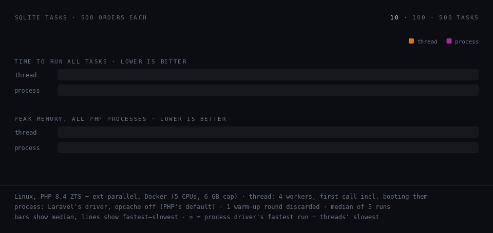
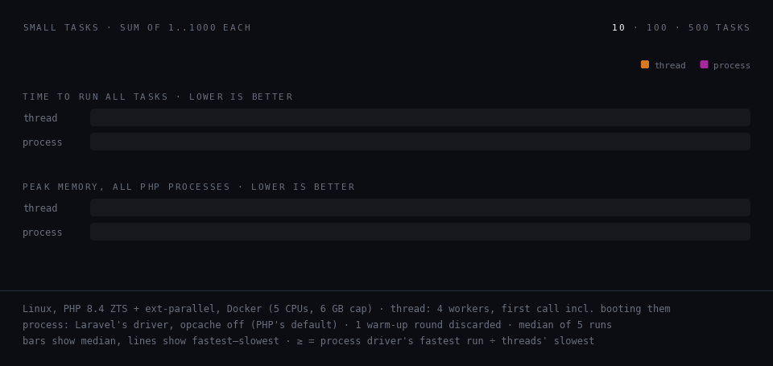

# omaresmael/thread

A thread-based concurrency driver for Laravel. Tasks run on a pool of PHP threads that boot your app once, so they’re far faster than the process driver (at least 77× on 500 database tasks) and use a fraction of its memory, without forking your app.

Laravel process driver starts a new `php artisan` process for every task: a process spawn, PHP startup and a full Laravel boot before your code runs, and a whole PHP process in memory per task. This package keeps a small pool of threads inside your PHP process instead. Each thread boots Laravel once and then runs task after task, so a task costs microseconds of overhead instead of hundreds of milliseconds, and the pool's memory stays flat no matter how many tasks you run. On the [benchmark](#benchmark), 500 database tasks finish in **0.18 s** using **65 MB**, against **16.5 s** and **1.9 GB** with the process driver.

Why threads instead of processes:

- **Lighter.** A thread is not a whole new PHP process: there is no process to spawn and no PHP to start, and a booted worker adds about 1.5 MB, against roughly 30 MB for every process the process driver starts.
- **Shares opcache.** All the threads live in one process, so they share its opcache: code PHP has compiled once is reused by every worker, which is why a worker boots in about 10 ms. Each process the process driver starts has its own opcache, so it compiles your app all over again.


## Installation

Requirements:

- **PHP 8.4 built thread-safe (ZTS)** with the **`parallel`** extension.
- **Laravel 13.**
- **`opcache.enable_cli=1`**, Optional, But strongly recommended

```bash
composer require omaresmael/thread
```

To publish the config file:

```bash
php artisan vendor:publish --tag=thread-config
```

## Usage

### Two ways to use it

Through the package's `Thread` facade:

```php
use Omaresmael\Thread\Facades\Thread;

Thread::run([
    fn () => User::count(),
    fn () => Order::count(),
]);
```

Or as a driver of Laravel's `Concurrency` facade, so existing code switches to threads without changes. Make it the default in `.env`:

```dotenv
CONCURRENCY_DRIVER=thread
```

```php
use Illuminate\Support\Facades\Concurrency;

Concurrency::run([
    fn () => User::count(),
    fn () => Order::count(),
]);
```

### Running tasks

```php
Thread::run(Closure|array $tasks, CarbonInterval|int|null $timeout = null, ?int $concurrent = null): array
```

Results keep the keys and order of the tasks:

```php
Thread::run([
    'x' => fn () => 1,
    7 => fn () => 2,
]);
// ['x' => 1, 7 => 2]
```

Tasks are called through the container, so dependency injection works, and `Context` is passed to them:

```php
use Illuminate\Contracts\Config\Repository;
use Illuminate\Support\Facades\Context;

Context::add('trace', 'abc');

Thread::run([
    fn (Repository $config) => [$config->get('app.name'), Context::get('trace')],
]);
```

Every task finishes before `run()` throws. If tasks failed, the first failure in key order is thrown:

- a task's exception is rebuilt with its original class and constructor arguments;
- a task that runs past its timeout throws `TaskTimedOutException`;
- a task that kills its worker (a fatal error, out of memory, `exit()`) throws `WorkerCrashedException` with the real error message. The crash is also reported to your exception handler.

### Timeouts

`$timeout` is seconds or a `CarbonInterval`. `null`, `0` or a negative value means no timeout.

```php
use Carbon\CarbonInterval;
use Omaresmael\Thread\Exceptions\TaskTimedOutException;

try {
    Thread::run([fn () => sleep(10)], 1);
} catch (TaskTimedOutException $e) {
    $e->key; // which task timed out
}

Thread::run([fn () => sleep(5)], CarbonInterval::milliseconds(500));
```

The clock starts when a task is handed to a worker. A task stuck in network I/O (a socket read, an HTTP call without a timeout) cannot be interrupted: `run()` still throws on time, but the thread keeps running until that I/O returns, and the process cannot exit before it does. Set timeouts on HTTP and database calls inside tasks.

### Concurrency

The pool keeps up to `max_workers` threads (4 by default); extra tasks wait in a queue. `$concurrent` changes that for one call:

```php
Thread::run($tasks, concurrent: 8);
```

Threads started beyond `max_workers` are closed when the call ends.

### Deferring

Run the tasks after the response is sent or the command finishes.
```php
Thread::defer([fn () => Report::generate()]);
```

### Configuration

| Key | Env | Default | |
|---|---|---|---|
| `max_workers` | `THREAD_MAX_WORKERS` | `4` | Maximum number of long-lived threads |
| `max_tasks` | `THREAD_MAX_TASKS` | `500` | Replace a worker after this many tasks (`null` to disable) |
| `max_memory` | `THREAD_MAX_MEMORY` | `128` | Replace a worker when its memory exceeds this many MB (`null` to disable) |

### Things to know

- **Write tasks as you would for Laravel Octane.** Static properties and objects you mutate on shared singletons survive between tasks on the same worker. Set `max_tasks` to `1` if you need a fresh boot for every task.
- **Threads share the process.** A crash of the PHP engine itself (a segfault) takes down your whole process. `putenv()` and `umask()` in a task affect the whole process.
- `STDIN`, `STDOUT` and `STDERR` do not exist inside tasks, and what a task `echo`s is discarded.

### Differences from the process driver

Results and task exceptions are the same: keys, order and rebuilt exceptions match Laravel's process driver. What differs:

| | Process driver | Threads |
|---|---|---|
| Tasks running at once | all of them, one process each | up to `max_workers` (4 by default); the rest wait in a queue. Raise it or use `concurrent:` |
| Config and `.env` | every task boots fresh from your files | workers keep the config they booted with; file changes need a restart of the process |
| A task that times out | throws `ProcessTimedOutException` | throws `TaskTimedOutException`; a task stuck in network I/O keeps running in the background until that I/O returns |
| A task that crashes | a generic exception with the exit code | `WorkerCrashedException` with the real error message, also reported to your exception handler |
| `defer()` | starts detached background processes | runs the tasks on the pool, in your process, after the response is sent or the command finishes |

## Benchmark

Laravel's process driver against the thread driver, called the same way (`Concurrency::driver('process')->run($tasks)` and `Concurrency::driver('thread')->run($tasks)`), at 10, 100 and 500 tasks. Times are the median of 5 runs, with the fastest and slowest run in brackets. "At least" divides the process driver's fastest run by the threads' slowest, so it holds even when the process driver is lucky; "typically" divides the medians.

### Database tasks

Each task loads one customer's 500 orders from SQLite with the query builder.



| Tasks | Process driver | Thread driver | Faster | Process driver memory | Thread driver memory | Less memory |
|---:|---:|---:|---:|---:|---:|---:|
| 10 | 492 ms (461–663 ms) | 39 ms (37–41 ms) | at least 11× (typically 13×) | 337 MB | 57 MB | at least 5× (typically 6×) |
| 100 | 3.8 s (3.7–4.2 s) | 77 ms (71–82 ms) | at least 45× (typically 49×) | 1,846 MB | 63 MB | at least 29× (typically 29×) |
| 500 | 16.5 s (15.4–18.3 s) | 176 ms (164–201 ms) | at least 77× (typically 93×) | 1,864 MB | 65 MB | at least 26× (typically 29×) |

### Small tasks

Each task returns `array_sum(range(1, 1000))`, so the numbers show the overhead each driver adds around your code.



| Tasks | Process driver | Thread driver | Faster | Process driver memory | Thread driver memory | Less memory |
|---:|---:|---:|---:|---:|---:|---:|
| 10 | 436 ms (370–508 ms) | 23 ms (18–26 ms) | at least 14× (typically 19×) | 319 MB | 47 MB | at least 6× (typically 7×) |
| 100 | 3.4 s (3.3–3.9 s) | 33 ms (33–35 ms) | at least 96× (typically 103×) | 1,575 MB | 47 MB | at least 32× (typically 34×) |
| 500 | 15.4 s (14.2–16.3 s) | 82 ms (81–89 ms) | at least 159× (typically 187×) | 1,408 MB | 47 MB | at least 28× (typically 30×) |

### How it was measured

- A Laravel 13 app on Linux, PHP 8.4 ZTS with `parallel` 1.2.15, in Docker with 5 CPUs and the container capped at 6 GB of memory.
- Time is one `run()` call in a fresh PHP process. For the thread driver that includes starting and booting its 4 workers; once they are running, the same calls take 3 ms, 34 ms and 113 ms (database tasks) and 2 ms, 13 ms and 61 ms (small tasks).
- Both drivers use their defaults: the process driver starts every task as its own process at once, the thread driver runs 4 workers. The process driver ran with PHP's default `opcache.enable_cli=0`, which boots its child processes faster; the threads ran with it on, as recommended.
- Memory is the peak combined memory (PSS) of every PHP process involved, sampled every 10 ms (the median is shown).
- Each measurement had 1 warm-up round, which was discarded, and a 5 s pause before it. All 60 measured runs succeeded.

To run it yourself, see [`benchmark/`](benchmark/README.md).
