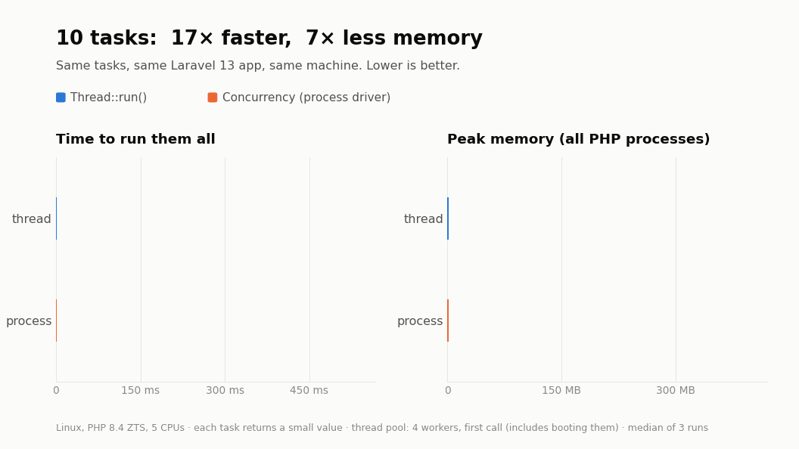

# omaresmael/thread

Run Laravel closures in parallel on a pool of threads that boot your app **once**, with the same API as Laravel's `Concurrency` facade.

Laravel's `Concurrency::run()` (the process driver) starts a new `php artisan` process for every task: a process spawn, PHP startup and a full Laravel boot before your code runs, and a whole PHP process in memory per task. This package keeps a small pool of threads inside your PHP process instead. Each thread boots Laravel once and then runs task after task, so a task costs microseconds of overhead instead of hundreds of milliseconds, and the pool's memory stays flat no matter how many tasks you run. On the [benchmark](#benchmark), 500 tasks finish in **0.08 s** using **48 MB**, against **21.9 s** and **2.2 GB** with the process driver.

```php
use Omaresmael\Thread\Facades\Thread;

[$users, $orders] = Thread::run([
    fn () => User::count(),
    fn () => Order::count(),
]);
```

Every task runs in a fresh copy of the booted app, and shared state (open transactions, the logged-in user, the locale, log context, `once()` values…) is reset after it, so a task never sees what the previous one left behind.

## Installation

Requirements:

- **PHP 8.4 built thread-safe (ZTS)** with the **`parallel`** extension. Most PHP installs (FPM, Herd, distro packages) are not thread-safe. The official `php:8.4-zts` Docker image plus `pecl install parallel` works. PHP 8.3 is not supported.
- **Laravel 13.**
- **`opcache.enable_cli=1`**, strongly recommended: threads share the compiled code, so a worker boots in about 10 ms and uses about 1.5 MB, against about 100 ms and 19 MB without it. Enable it for the processes that run threads, e.g. `php -d opcache.enable_cli=1 artisan queue:work`. If it is off, the package logs a warning once per process.
- Linux is the tested platform.

```bash
composer require omaresmael/thread
```

The service provider and the `Thread` facade are auto-discovered. To publish the config file:

```bash
php artisan vendor:publish --tag=thread-config
```

The package can be installed in an app that also runs on normal (non-thread-safe) PHP, such as an FPM web server sharing the codebase: nothing is checked when the app boots. Calling `Thread::run()`, `Thread::defer()` or `Thread::warm()` there throws a `ThreadUnavailableException` that says what is missing.

## Usage

### Running tasks

```php
Thread::run(Closure|array $tasks, CarbonInterval|int|null $timeout = null, ?int $concurrent = null): array
```

Results keep the keys and order of the tasks:

```php
Thread::run([
    'x' => fn () => 1,
    7 => fn () => 2,
]);
// ['x' => 1, 7 => 2]
```

Tasks are called through the container, so dependency injection works, and `Context` is passed to them:

```php
use Illuminate\Contracts\Config\Repository;
use Illuminate\Support\Facades\Context;

Context::add('trace', 'abc');

Thread::run([
    fn (Repository $config) => [$config->get('app.name'), Context::get('trace')],
]);
```

Every task finishes before `run()` throws. If tasks failed, the first failure in key order is thrown:

- a task's exception is rebuilt with its original class and constructor arguments;
- a task that runs past its timeout throws `TaskTimedOutException`;
- a task that kills its worker (a fatal error, out of memory, `exit()`) throws `WorkerCrashedException` with the real error message. The crash is also reported to your exception handler.

### Timeouts

`$timeout` is seconds or a `CarbonInterval`. `null`, `0` or a negative value means no timeout.

```php
use Carbon\CarbonInterval;
use Omaresmael\Thread\Exceptions\TaskTimedOutException;

try {
    Thread::run([fn () => sleep(10)], 1);
} catch (TaskTimedOutException $e) {
    $e->key; // which task timed out
}

Thread::run([fn () => sleep(5)], CarbonInterval::milliseconds(500));
```

The clock starts when a task is handed to a worker. A task stuck in network I/O (a socket read, an HTTP call without a timeout) cannot be interrupted: `run()` still throws on time, but the thread keeps running until that I/O returns, and the process cannot exit before it does. Set timeouts on HTTP and database calls inside tasks.

### Concurrency

The pool keeps up to `max_workers` threads (4 by default); extra tasks wait in a queue. `$concurrent` changes that for one call:

```php
Thread::run($tasks, concurrent: 8);
```

Threads started beyond `max_workers` are closed when the call ends. For CPU-bound tasks use about the number of CPU cores; I/O-bound tasks can use more, limited by memory and your database's connection limit, since every worker holds its own connections.

### Deferring and warming up

```php
// Run the tasks after the response is sent or the command finishes.
Thread::defer([fn () => Report::generate()]);

// Start the workers up front, e.g. at the beginning of a queue worker.
Thread::warm();
Thread::warm(2);
```

### Configuration

| Key | Env | Default | |
|---|---|---|---|
| `max_workers` | `THREAD_MAX_WORKERS` | `4` | Maximum number of long-lived threads |
| `max_tasks` | `THREAD_MAX_TASKS` | `500` | Replace a worker after this many tasks (`null` to disable) |
| `max_memory` | `THREAD_MAX_MEMORY` | `128` | Replace a worker when its memory exceeds this many MB (`null` to disable) |

The settings are read once per process, when the pool starts.

## Benchmark



| Tasks | Process driver | `Thread::run()` | Faster | Process driver memory | `Thread::run()` memory | Less memory |
|---:|---:|---:|---:|---:|---:|---:|
| 10 | 430 ms | 25 ms | 17× | 318 MB | 47 MB | 7× |
| 100 | 5.2 s | 32 ms | 161× | 1,932 MB | 48 MB | 40× |
| 500 | 21.9 s | 82 ms | 269× | 2,174 MB | 48 MB | 45× |

How it was measured:

- A Laravel 13 app on Linux, PHP 8.4 ZTS with `parallel` 1.2.15, 5 CPUs and 8 GB of memory in Docker.
